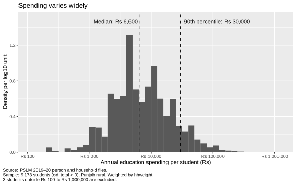
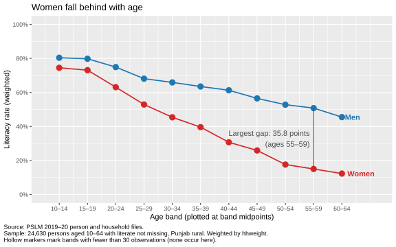
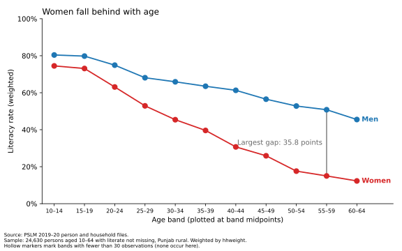

# ECO346-A1-FA24-BEDS-056
 
**Course:** ECO346 Data Visualization Techniques for Economists, Assignment 1, Fall 2026
**Name:** Muhammad Mubashar Murtaza
**Registration no.:** FA24-BEDS-056
**Section:** B
 
## Variant
 
Registration number ends in 56, and 56 = 7 × 8 + 0, so **variant 0: Punjab rural**
(`prov_code == 2` and `urban_rural == 1`).
 
## Repository structure
 
```
README.md    this file
data/        pslm_person_subset.csv, pslm_hh_subset.csv
scripts/     one script per figure, numbered in the order they run
figures/     every figure, saved as SVG by the scripts
tables/      band table exported from R, used by the Python check
slides/      FA24-BEDS-056.pptx
```
 
## How to reproduce
 
Clone the repository and run the scripts in order from the repository root.
No internet connection is needed; the scripts read the local CSVs in `data/`.
 
1. `scripts/00_explore.R` inspects the data (no output files)
2. `scripts/01_default.R` creates `figures/default.svg`
3. `scripts/02_distribution.R` creates `figures/distribution.svg`
4. `scripts/03_literacy.R` creates `figures/literacy_by_age.svg` and `tables/band_table_R.csv`
5. `scripts/04_second_language.py` creates `figures/literacy_by_age_python.svg` and checks its table against R's
R packages: tidyverse, svglite. Python packages: pandas, numpy, matplotlib.
 
## Figure 1: Distribution of education spending (Question 2)
 

 
**Key numbers**
 
| Quantity | Value |
|---|---|
| Students (ed_total > 0) | 9,173 |
| Weighted median | Rs 6,600 |
| Unweighted median | Rs 7,000 |
| Weighted 10th percentile | Rs 2,000 |
| Weighted 90th percentile | Rs 30,000 |
| P90 / P10 ratio | 15.00 |
| Students excluded (outside Rs 100 to Rs 1,000,000) | 3 |
 
**Interpretation:** Most students' annual spending lies between Rs 2,000 and Rs 30,000 (weighted 10th and 90th percentiles, a ratio of 15), with a weighted median of Rs 6,600 and a long right tail. The unweighted median, Rs 7,000, is slightly higher. Students at or below the median carry slightly larger weights on average (218 against 209), so weighting pulls the median down a little; the gap is small because weights vary little with spending.
 
## Figure 2: Literacy by age and sex (Question 3)
 

 
### Band table
 
| Age band | Women: n | Women: weighted literacy (%) | Men: n | Men: weighted literacy (%) |
|----------|----------|------------------------------|--------|----------------------------|
| 10–14 | 2,133 | 74.5 | 2,209 | 80.4 |
| 15–19 | 1,758 | 73.1 | 1,922 | 79.8 |
| 20–24 | 1,574 | 63.1 | 1,449 | 74.9 |
| 25–29 | 1,386 | 52.9 | 1,201 | 68.1 |
| 30–34 | 1,176 | 45.4 | 1,037 | 65.9 |
| 35–39 | 1,194 | 39.6 | 1,006 | 63.5 |
| 40–44 | 903 | 30.7 | 843 | 61.3 |
| 45–49 | 776 | 25.9 | 737 | 56.5 |
| 50–54 | 657 | 17.6 | 708 | 52.8 |
| 55–59 | 535 | 15.0 | 517 | 50.8 |
| 60–64 | 412 | 12.3 | 497 | 45.5 |
 
No band has fewer than 30 observations, so no marker is hollow.
 
**Key numbers**
 
| | Women | Men |
|---|---|---|
| Aged 15–19 | 73.1% | 79.8% |
| Aged 55–59 | 15.0% | 50.8% |
 
The band with the largest gap is **55–59** (35.8 percentage points).
 
**Interpretation:** Literacy falls with age for both sexes, but much faster for women. At ages 15–19 women (73.1%) trail men (79.8%) by 6.7 points; at ages 55–59 the gap is 35.8 points (15.0% against 50.8%). This is consistent with schooling expanding for younger cohorts, especially girls, in rural Punjab. The figure cannot tell us whether this reflects ageing or cohort differences, because a single cross-section cannot separate the two.
 
## Makeover (Question 4)
 
Default:  | Redesign: 
 
**Explanation:** The default drew 24,630 raw points on two heights, so overplotting hid how many people each dot held. I replaced them with weighted conditional means by age band, so each marker shows a rate on a common aligned scale, the most accurate perceptual channel. Second, I split women and men and labelled the lines directly, removing the legend (data–ink). Third, I set the axis to 0–100% with percent labels and plotted bands at midpoints. The default shows individual ages and every observation; my redesign hides variation within five-year bands and the counts behind each rate.
 
## Second language (Question 5)
 
Language used: Python
 

 
**Literacy rate of women aged 15–19:** R = 73.1, Python = 73.1.
The two band tables agree in all 22 cells (maximum absolute difference 0.0).
 
**Difference in defaults:** The default figure size differed: ggsave() uses a 7 × 7 inch square, while matplotlib uses 6.4 × 4.8 inches. I set both to 8 × 5 inches so the figures match. Band edges also needed care: cut() and pd.cut() both default to right-closed intervals, so I set right = FALSE in each to get the assignment's left-closed bands, [10, 15), [15, 20), and so on.
 
## Data source
 
PSLM 2019–20 person and household files (course repository: github.com/rafi-amiruddin/DVTE).
All statistics are weighted by `hhweight` unless stated otherwise.
